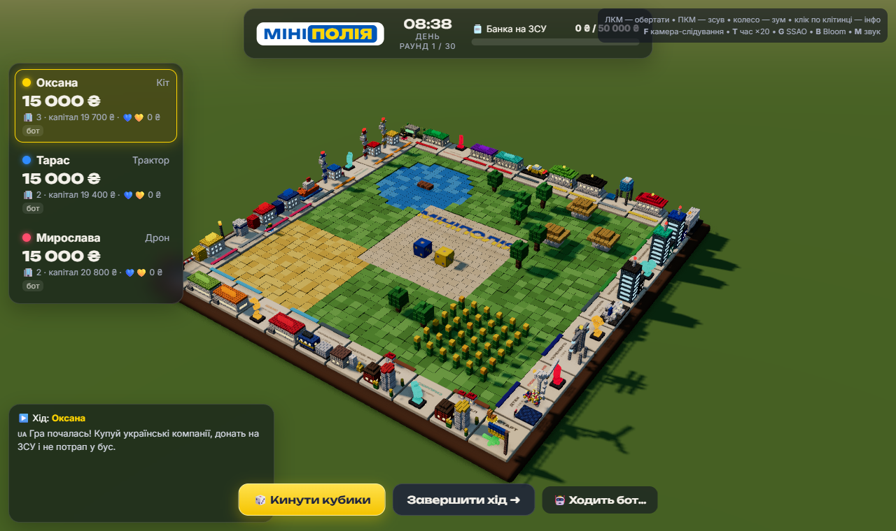
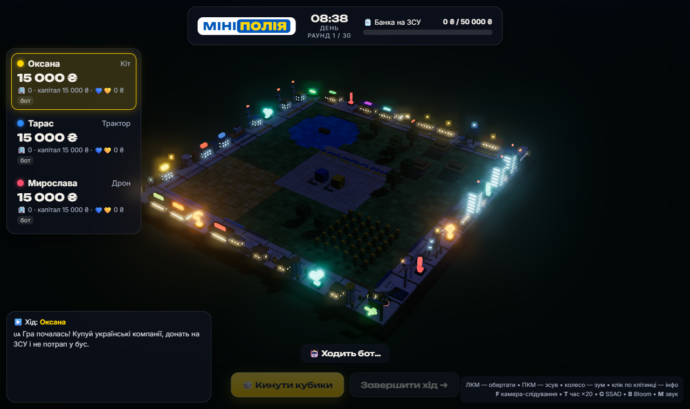
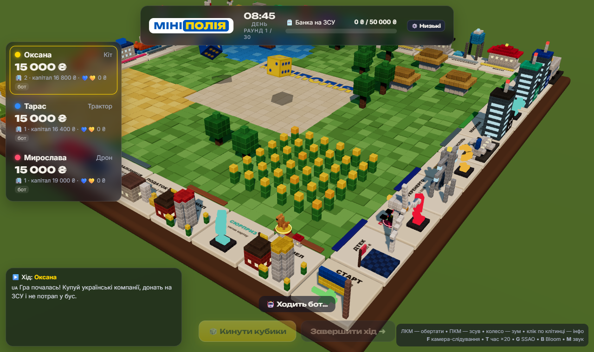

# 🇺🇦 Мініполія — українська воксельна бізнес-гра

Браузерна 3D-гра в жанрі «економічна настільна гра» (купуй компанії, збирай оренду, не збанкрутуй)
у стилі **voxel / low-poly** із сучасною постобробкою. Клітинки — українські компанії та бренди
(пародійно/фанатськи), картки подій — з українським контекстом і гумором.

## Запуск (без збірки, без npm)

```bash
cd minipolia
python -m http.server 8080     # або просто двічі клікнути start.bat
# відкрити http://localhost:8080
```

Потрібен інтернет: Three.js (r165) і шрифти підтягуються з CDN через `importmap`.

### Налаштування графіки

Пресет обирається в стартовому меню або кнопкою **⚙️** у верхній панелі. Вибір зберігається
в `localStorage`, а застосовується перезапуском сторінки, бо рендерер створюється з нуля.

| Пресет | Статус | Що вмикає |
|---|---|---|
| Бомж ПК | скоро | — |
| **Низькі** | ✅ | без постобробки, MSAA, одне сонце, **статичні тіні запечені** (карта тіней рендериться один раз і перезапікається лише після купівлі/філії), **тіні фішок і кубиків — у реальному часі** (проєктовані), запечене AO вокселів замість SSAO, pixel ratio 1 |
| Середні | скоро | — |
| Високі | скоро | — |
| **Ультра** | ✅ | CSM (3 каскади, щокадру), GTAO, HDR-Bloom, SMAA, pixel ratio до 1.5, сонце рухається |

URL-перевизначення: `?quality=low` / `?quality=ultra`; для «Ультра» — `?ssao=0`, `?bloom=0`, `?csm=0`.

Як влаштовані «Низькі»:
- `Engine.bakeShadows()` вмикає `sun.shadow.needsUpdate` при `shadow.autoUpdate = false`, тобто один прохід карти тіней замість щокадрового.
- Рухомі об'єкти (фішки, кубики, конфетті) не потрапляють у карту тіней. Їхню тінь малює `world/PlanarShadow.js`:
  геометрія щокадру проєктується на площину вздовж напрямку сонця, stencil не дає тіні подвоюватися.
- Напрямок сонця фіксований під кутом, близьким до полудня, щоб запечені тіні збігалися з освітленням. Кольори доби (світанок/вечір/ніч) змінюються як завжди.
- `VoxelModel.bakedAO()` затемнює кожен воксель за кількістю сусідів: дешева заміна SSAO.

Клавіші: **Пробіл** — кинути кубики / завершити хід, **F** — камера-слідування, **T** — час ×20,
**G** — SSAO, **B** — Bloom, **M** — звук. Клік по клітинці показує інформацію про неї.

## Що вже працює (MVP)

- **Графіка:** воксельні моделі з фаскою (44 трикутники на воксель, InstancedMesh), каскадні тіні (CSM, 3 каскади),
  GTAO (сучасний SSAO з денойзом), HDR-Bloom для неонових вивісок, SMAA, ACES-тонмапінг.
- **Цикл доби:** небо-градієнт із сонцем, світанок → день → помаранчевий вечір → синя ніч із зірками,
  місячне світло, вночі вітрини й вивіски світяться.
- **Анімації:** фішки стрибають клітинками зі сквош-стретчем, кубики котяться й лягають потрібною гранню догори,
  будівля «підстрибує» при купівлі, конфетті + іскри + воксельний дим, лопаті вітряка крутяться, гліфи карток левітують.
- **40 клітинок:** 28 компаній у 10 групах, кожен сектор має свою воксельну модель
  (поштомат «Нової Пошти», локомотив Укрзалізниці, кораблик Укррічфлоту, IT-вежі, ЛЕП Укренерго, вітряк ДТЕК…).
- **Кути:** Старт, ТЦК (блокпост), Укриття (бомбосховище), Бус ТЦК.
- **3 колоди × 23 картки:** Шанс / Сюрприз / Покарання, зокрема «Бусифікація на Донбас», «Повітряна тривога»,
  «Донат на банку», «Успішний пітч», «Грант від держави», «Дмитро Комаров привіз донат».
- **Механіки:** купівля, оренда (монополія ×2), філії до 3 рівнів, транспорт / комуналка, дублі,
  три дублі = бус, автопродаж компаній при боргах, банкрутство, **спільна банка на ЗСУ** з прогресом,
  ліміт 30 раундів із перемогою за капіталом, боти, гра з 2–4 гравцями на одному пристрої.

## Архітектура

```
minipolia/
├── index.html              # importmap (three@0.165), шрифти, контейнери
├── start.bat               # запуск локального сервера на Windows
├── css/style.css           # скляний HUD, картки, тривога
├── src/
│   ├── main.js             # bootstrap + GameView (міст між логікою і 3D/HUD)
│   ├── config.js           # налаштування, баланс, ПРЕСЕТИ ГРАФІКИ, гравці за замовчуванням
│   ├── core/               # ── РЕНДЕР-ЯДРО ──
│   │   ├── Engine.js       # renderer, сцена, камера, OrbitControls, CSM-сонце, спільні матеріали
│   │   ├── PostFX.js       # EffectComposer: Render → GTAO → Bloom → Output → SMAA
│   │   └── DayNight.js     # ключові кадри доби, небо-шейдер, зірки, туман, сила неону
│   ├── world/              # ── 3D-СВІТ ──
│   │   ├── VoxelBuilder.js # VoxelModel: set/box/cylinder/glyph → InstancedMesh (solid + glow)
│   │   ├── models.js       # процедурні моделі секторів і кутів
│   │   ├── Board.js        # дошка, клітинки, підписи (Canvas), центр-декор, прапорці, філії, координати
│   │   ├── Token.js        # воксельні фішки (кіт, трактор, дрон, пес-сапер) + стрибки
│   │   ├── Dice.js         # 3D-кубики з детермінованим «приземленням» на потрібну грань
│   │   ├── Particles.js    # пули частинок: конфетті, іскри (Bloom), дим
│   │   └── PlanarShadow.js # проєктовані тіні фішок/кубиків у реальному часі («Низькі»)
│   ├── game/               # ── ЛОГІКА (без Three.js і DOM) ──
│   │   ├── Game.js         # черга ходів, рух, купівля, оренда, бусифікація, тривога, банкрутство
│   │   ├── CardSystem.js   # колоди та інтерпретатор ефектів карток
│   │   ├── rules.js        # чисті функції: оренда, філії, капітал
│   │   └── data/
│   │       ├── tiles.js    # 40 клітинок і групи
│   │       └── cards.js    # картки як ДАНІ (title, text, effect)
│   ├── ui/HUD.js           # меню, гравці, банка ЗСУ, журнал, діалоги, картки, інфо клітинки
│   ├── audio/Sfx.js        # процедурний звук на WebAudio (без файлів)
│   └── utils/tween.js      # твіни на промісах + seeded RNG
└── tools/
    ├── logic-test.html     # прогін N ігор ботів із фейковим view + перевірка інваріантів
    └── smoke_test.py       # Playwright: скріншоти та помилки консолі
```

### Ключові рішення

1. **Логіка відокремлена від рендера.** `Game` нічого не знає про Three.js: він викликає методи
   `view` (`movePlayer`, `showCard`, `choose`, `sendToShelter`…) і `await`-ить їх. Через це
   `tools/logic-test.html` ганяє десятки повних ігор за секунди з фейковим view.
2. **Картки — це дані.** Нова картка = новий об'єкт у `cards.js`. Новий тип ефекту = новий `case` у `CardSystem.apply`.
3. **Анімації на промісах.** `tween()` / `wait()` повертають Promise і оновлюються з render-loop,
   тому сценарій ходу читається лінійно: `await rollDice → await movePlayer → await resolveTile`.
4. **Продуктивність.** Кожна будівля = 1–2 InstancedMesh; спільні матеріали; колір через `instanceColor`;
   «світні» вокселі — `MeshBasicMaterial` з HDR-множником, який DayNight піднімає вночі.
5. **CSM-сумісність.** Усі освітлені матеріали створюються через `engine.std()` (там `csm.setupMaterial`).
   Якщо створити `MeshStandardMaterial` напряму, він буде пересвічений.

### Механіка «Бусифікації» (`Game.busification`)
Картка або клітинка «Бус ТЦК» → вибір:
- **Задонатити 3 000 ₴ на ЗСУ** («викупити бус»): гроші йдуть у спільну банку й рахуються в особисту статистику донатів;
- **Сісти в бус:** фішка перелітає на «ТЦК», гравець пропускає 2 ходи.

Боти платять, якщо після цього лишається понад 4 000 ₴. Три дублі поспіль — автоматично бус.

### «Повітряна тривога» (`Game.airRaid`)
Усі гравці, крім тих, хто в ТЦК, отримують `inShelter = true` і `skipTurns + 1`. Фішки по черзі перелітають
до клітинки «Укриття», на екрані червона віньєтка з сиреною. На своєму пропущеному ході гравець
повертається на свою клітинку («Відбій!»).

## Тести

```bash
python -m http.server 8080
# відкрити http://localhost:8080/tools/logic-test.html
```
Останній прогін: 12 ігор по 4 боти — PASS, усі завершилися, усі 23 картки випадають, порушень інваріантів немає
(від'ємних балансів або власності в банкрутів).

## Що далі (після MVP)

- Аукціон, якщо гравець відмовився купувати; обмін компаніями між гравцями.
- Онлайн-мультиплеєр (WebSocket / WebRTC): `Game` уже серіалізований у `state`.
- Збереження гри в `localStorage`.
- Анімація бусу, що під'їжджає по дорозі; воксельна сирена на кожному куті.
- Пресети «Бомж ПК», «Середні», «Високі»; автовибір пресету за продуктивністю (мобільні → «Низькі»).

> Назви компаній використані в некомерційному пародійному контексті й не означають, що бренди мають стосунок до гри.

## Скріншоти

Ультра, день / ніч:




Низькі (запечені тіні + тіні фішок у реальному часі):


